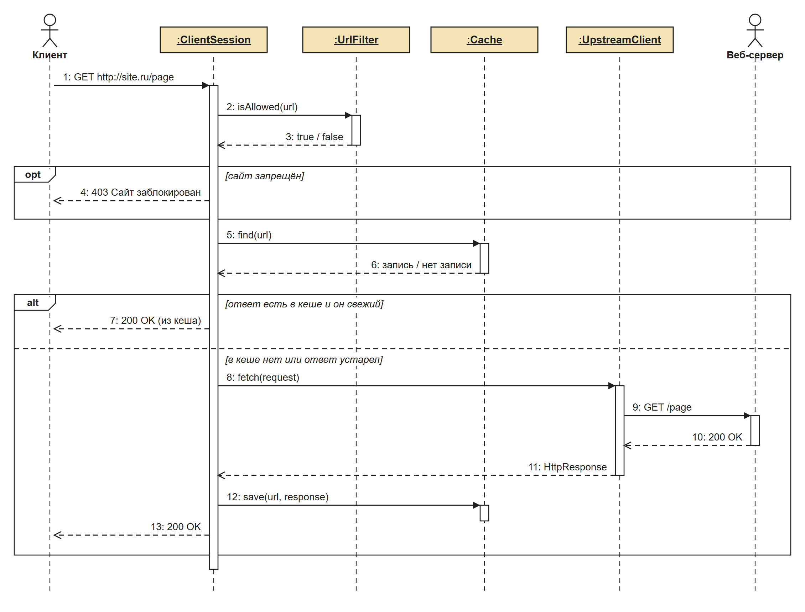
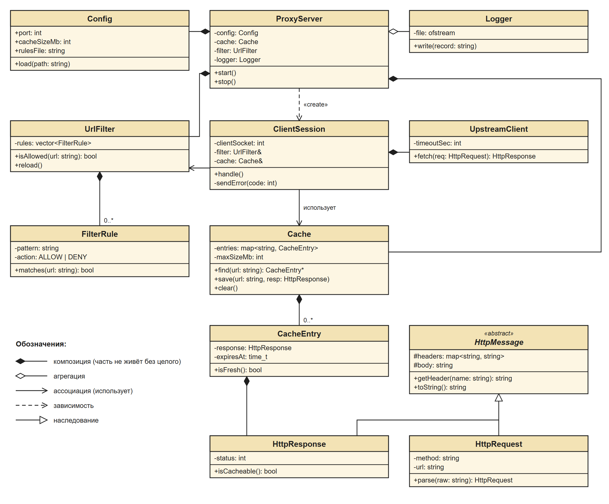
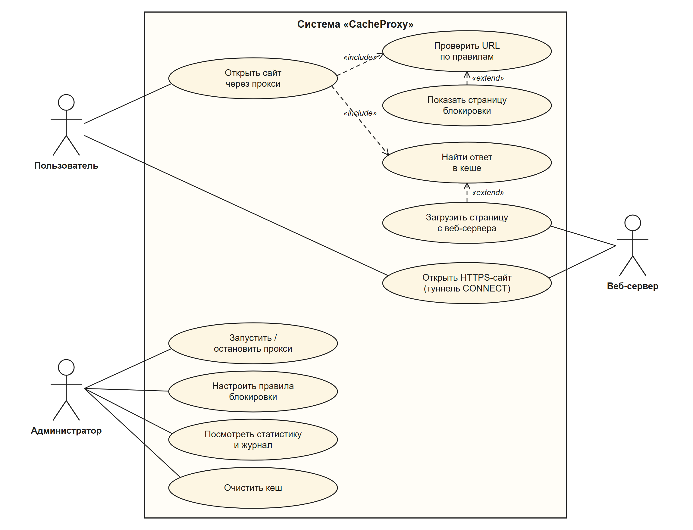

# CacheProxy

HTTP-прокси-сервер с кешированием и фильтрацией URL на C++.

Учебный проект по дисциплине «Технологии индустриального программирования» (РТУ МИРЭА).

## Что делает

CacheProxy ставится между компьютерами локальной сети (например, учебного класса) и интернетом:

- принимает HTTP-запросы пользователей и пересылает их на сайты;
- сохраняет ответы в кеш и при повторном запросе отдаёт их сразу, не обращаясь к сайту;
- блокирует запрещённые сайты по правилам администратора;
- пропускает HTTPS-сайты через метод CONNECT, не расшифровывая их;
- ведёт журнал запросов и статистику (сколько ответов отдано из кеша).

## Как обрабатывается запрос

1. Прокси проверяет адрес сайта по правилам блокировки.
2. Если сайт запрещён, прокси отвечает `403` и показывает страницу «Сайт заблокирован».
3. Если ответ уже есть в кеше и он не устарел, прокси сразу его отдаёт.
4. Иначе прокси загружает страницу с сайта, сохраняет её в кеш и отдаёт пользователю.

## Основные классы

| Класс | Назначение |
|---|---|
| `ProxyServer` | Главный класс: хранит настройки, кеш, фильтр и журнал, принимает подключения |
| `ClientSession` | Обрабатывает запрос одного клиента |
| `UrlFilter`, `FilterRule` | Правила блокировки и проверка адресов |
| `Cache`, `CacheEntry` | Кеш ответов и одна запись в нём |
| `UpstreamClient` | Загружает страницы с веб-серверов |
| `HttpMessage`, `HttpRequest`, `HttpResponse` | HTTP-запрос и HTTP-ответ |
| `Config`, `Logger` | Настройки и журнал запросов |

## Варианты использования

## Документация

- [Требования к программе (SRS), PDF](docs/SRS_CacheProxy.pdf)
- [UML-диаграммы](docs/diagrams)

## Технологии

- C++17, CMake
- Linux и Windows
- Разбор HTTP, кеш и фильтр пишутся самостоятельно, без готовых прокси-библиотек

## Статус

Готовы требования и UML-диаграммы. Реализация на C++ ещё не начата.

## Команда

Группа ЭФБО-04-25:

- Коптилин Илья Русланович
- Кирбитов Артем Евгеньевич
- Звягин Тимур Олегович
